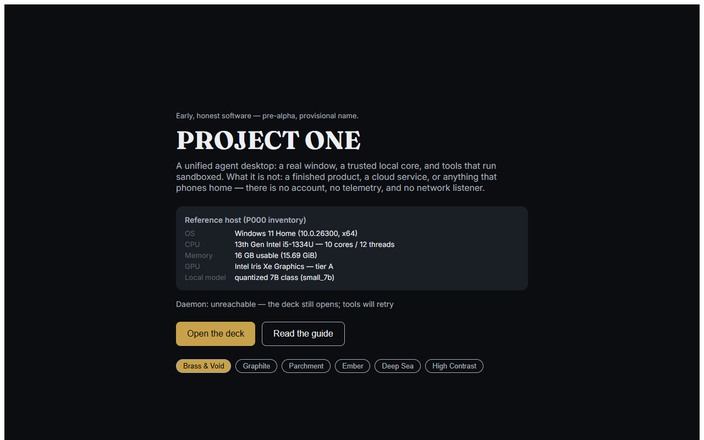
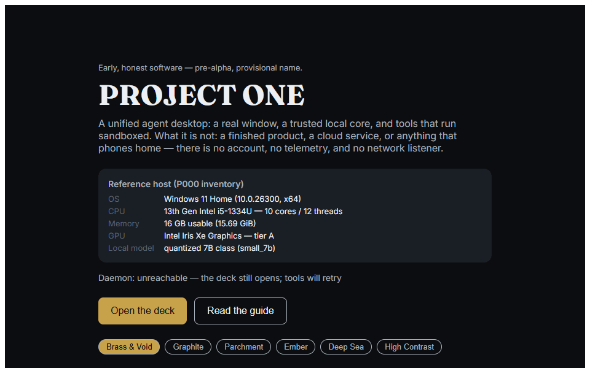
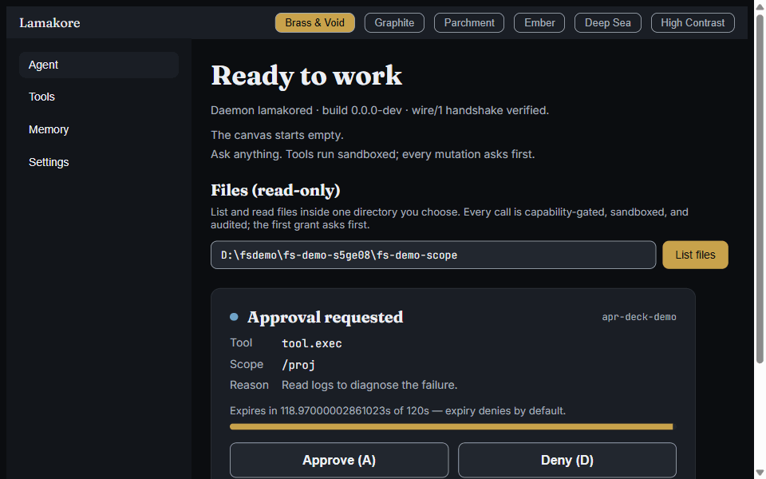

# Lamakore

An open-source unified agent desktop: a real window driven by a trusted local core over a local-only protocol, with every tool sandboxed.

> **Status: pre-alpha. Provisional name — not cleared for distribution.**
> Nothing here is finished, nothing phones home, and no binary release
> exists yet. The name, the marks, and the registries are all pending
> clearance (see TRADEMARK.md and ADR-003).

[](https://github.com/oneatelier/lamakore/actions/workflows/ci.yml)
[](https://github.com/oneatelier/lamakore/actions/workflows/hygiene.yml)
[](LICENSE)




*First run (brass-void). The GIF below walks it: read the guide, open the deck.*



*Files deck (brass-void). GIF #2: approve the first grant, then read — every outcome audited.*



## What this is

- A **real desktop window** (Electron 45.4.1) that treats web content as hostile.
- A **trusted Rust core** (`cored`) that owns credentials, policy, and tool dispatch.
- A **local-only wire protocol** (`wire/1`, named pipes / Unix sockets — never TCP).
- **Real read-only workspace tools** (`fs.list` / `fs.read`): sandboxed
  helpers, capability-checked per call, approval card on first grant,
  hash-chained audit on every outcome — driven from the deck's Files panel.
- **Real secret handling**: provider keys live only in the OS keychain
  (Settings panel: masked input, provider select, one explicit test
  request, zero background calls); plaintext never crosses the wire to the deck.
- **Sandboxed tools**: Job Objects + AppContainer first (Tier-1 enforced),
  POSIX Landlock/seccomp/Seatbelt where present, hypervisor tiers later.
- **Design tokens as code** (Brass & Void), verified contrast, keyboard-first.

## What this is not

- Not a finished product. Screens say what they cannot do yet.
- Not a cloud service. No accounts, no telemetry, no open ports.
- Not cleared for distribution: the name is provisional, the marks are
  unregistered, and `clearance.publishBlocked` is `true`.

```
┌──────────────┐   contextBridge (allowlisted)   ┌─────────────────────┐
│   RENDERER   │ ◄──── invoke/subscribe/un ──────► │   PRELOAD (sandbox) │
│ untrusted UI │         wire/1 frames            │                     │
└──────────────┘                                   └────────┬────────────┘
                                                          named pipe /
                                                     Unix socket (no TCP)
                                                    ┌───────▼────────┐
                                                    │     DAEMON     │
                                                    │  trusted core  │
                                                    └───────┬────────┘
                                                      capability-checked
                                                    ┌───────▼────────┐
                                                    │ SANDBOXED TOOLS│
                                                    └────────────────┘
```

Renderer = untrusted UI. Daemon = trusted core. Tools = sandboxed.
Full statement: `docs/adr/ADR-000-host-profile-and-threat-boundary.md`.

## Quickstart (real commands, pinned toolchain)

```sh
git clone <org-url> && cd lamakore
powershell -ExecutionPolicy Bypass -File scripts/bootstrap/windows.ps1
# or: ./scripts/bootstrap/macos.sh  |  ./scripts/bootstrap/linux.sh
node scripts/bootstrap/verify.mjs
cargo build -p cored
node scripts/build-desktop.mjs
node --test tests/e2e/handshake.spec.ts
```

Pins: Rust 1.100.0 · pnpm 12.22.0 · Node 24.x LTS · Electron 45.4.1.
Details: `artifacts/toolchain.lock.json`, `docs/adr/ADR-001-toolchain-pins.md`.

## Repository map

- `apps/desktop` — Electron shell (main, preload, renderer).
- `crates/cored` — trusted daemon. `crates/core-protocol` — `wire/1`.
  `crates/core-policy`, `crates/core-sandbox`, `crates/core-store` — libraries.
- `packages/ui` — design system. `packages/sdk` — plugin SDK.
  `packages/branding` — generated brand accessors.
- `ee/` — commercial boundary (`ee/README.md`). `eval/` — fixtures, goldens, runners.
- `audit/` — vision-alignment audit agent. `artifacts/` — machine-readable specs.
- `docs/adr`, `docs/reports`, `docs/guides` — decisions, evidence, how-tos.

## The two quality gates

Every change ships with a report under `docs/reports/` proving both:

1. **[E] Evidence gate** — machine-checkable: exact commands, exit codes,
   hashes, measured numbers. A claim without evidence is a draft.
2. **[V] Visual gate** — anything a human sees is reviewed by a human, with
   screenshots committed as evidence (see `assets/demo/`, `artifacts/*token-sheet*.png`).

No gate may be marked passed without its evidence. See CONTRIBUTING.md.

## Parity scoreboard

[Machine-readable scoreboard](artifacts/parity-scoreboard.md) — currently
**"no evidence yet"**, honestly. It turns green only from eval results,
never from prose. Roadmap: [roadmap.json](artifacts/roadmap.json) ·
[vision rubric](artifacts/vision-rubric.json).

## Security

Suspected vulnerability? **Do not open a public issue.**
Email security@project-one.dev or use GitHub Private Vulnerability
Reporting once the repo is public. 90-day policy, tool-execution bugs
explicitly in scope. Full policy: [SECURITY.md](SECURITY.md).

## Contributing

Read [CONTRIBUTING.md](CONTRIBUTING.md): DCO sign-off (`git commit -s`)
on every commit, `<type>(P0NN)` subjects, both gates evidenced.
Be kind; see [CODE_OF_CONDUCT.md](CODE_OF_CONDUCT.md). Governance:
[GOVERNANCE.md](GOVERNANCE.md).

## License and trademark

Apache-2.0 — see [LICENSE](LICENSE). Copyright 2026 The Lamakore Authors.
The name and marks are **provisional** and not licensed for reuse; policy
modeled on the Apache/PostgreSQL pattern: [TRADEMARK.md](TRADEMARK.md).

## Acknowledgements

No users yet, no testimonials to quote, no download counts to show.
Thanks, in advance, to the future reviewers, issue filers, and the Owner
running the key ceremony. The audit trail starts here:
[`docs/reports/`](docs/reports/).
